# Xeque-Mago

Estratégia de turnos em voxel: cada jogador tem um **Mago**, que é o rei, e um exército de bonecos.
Derrube o Mago inimigo para vencer, sem perder o seu.

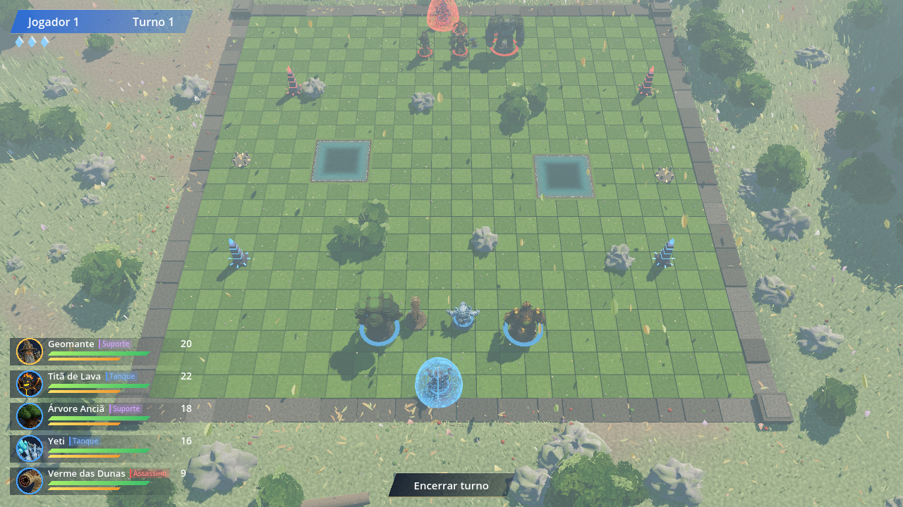

## Baixar e jogar (Windows)

1. Abra a aba **[Releases](../../releases/latest)** e baixe `XequeMago-v0.5-windows.zip`.
2. Extraia o zip numa pasta.
3. Rode `XequeMago.exe`. Os dois arquivos (`.exe` e `.pck`) precisam ficar na mesma pasta.

Se o Windows mostrar "O Windows protegeu o computador", clique em **Mais informações → Executar assim mesmo**
(o jogo ainda não é assinado digitalmente).

Requisitos: Windows 10 ou 11 (64 bits) e placa de vídeo com Vulkan.
Se o jogo pesar no seu PC, vá em **Opções → Qualidade gráfica** e escolha **Baixa** ou **Média**.

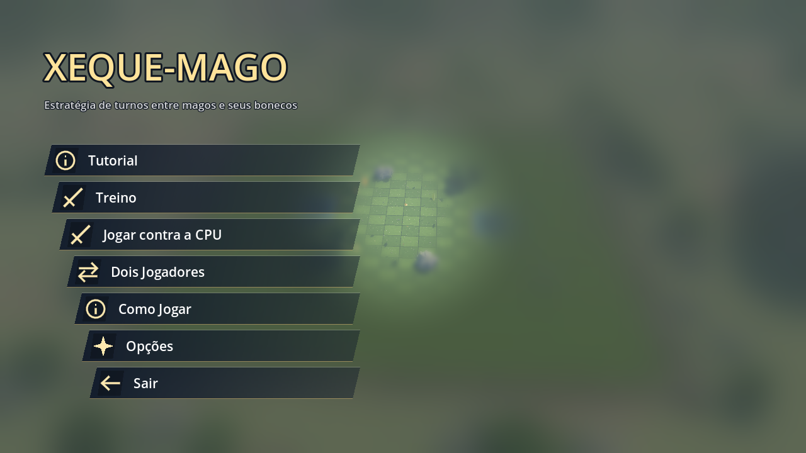

## Modos

- **Tutorial**: 11 lições curtas, uma para cada parte do jogo
- **Treino**: um campo com bonecos de pancada para testar os golpes de qualquer boneco
- **Contra a CPU**
- **Dois jogadores** no mesmo computador, passando a vez

## Tutorial

Cada lição monta um cenário próprio e guia clique a clique: o painel explica a mecânica, mostra o
próximo clique e marca a casa certa. As lições feitas ficam marcadas.

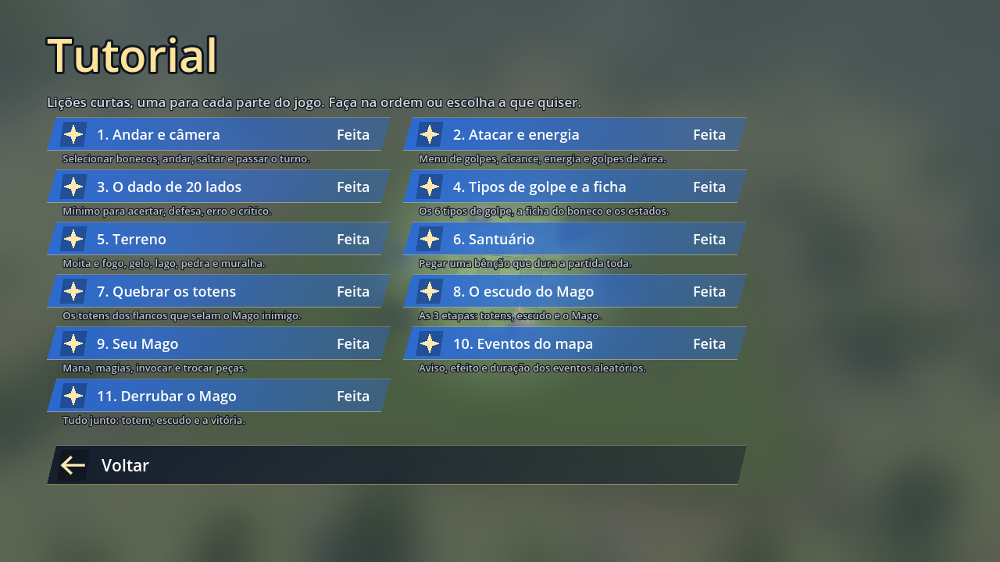

1. Andar e câmera · 2. Atacar e energia · 3. O dado de 20 lados · 4. Tipos de golpe e a ficha · 5. Terreno ·
6. Santuário · 7. Quebrar os totens · 8. O escudo do Mago · 9. Seu Mago · 10. Eventos do mapa · 11. Derrubar o Mago

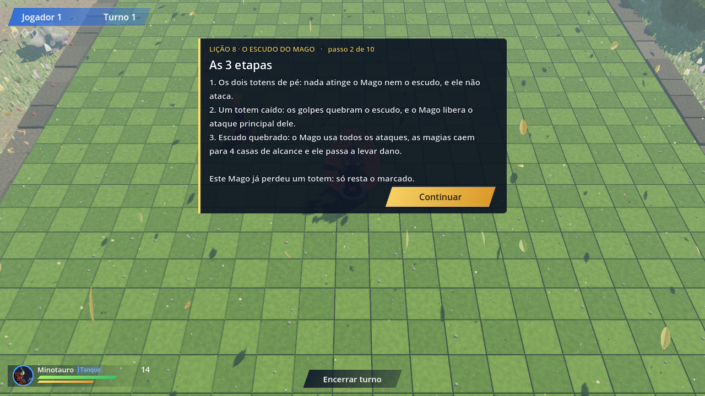

## Campo de Treino

Escolha qualquer boneco e bata nos bonecos de pancada: um colado, dois a 3 casas, um a 5 e um a 7 casas, mais um
aliado de pancada para os golpes de aliado. Eles voltam com a vida cheia a cada turno, e a energia infinita pode
ser ligada ou desligada. No canto de cima, a ficha do boneco em uso mostra a vida e a energia; passando o mouse num
golpe, as bolinhas de energia que ele gasta ficam vermelhas.

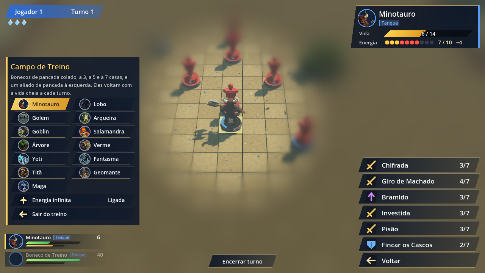

## Como funciona

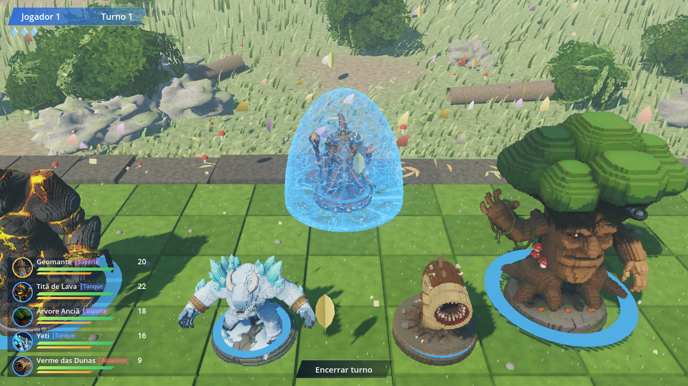

A defesa do Mago tem **três etapas**:

1. **Os dois totens de pé.** Cada lado tem dois totens nos flancos. Enquanto os dois estão de pé, nada atinge o
   Mago, nem o escudo dele, e ele só usa magias de suporte (cura, escudo, potencializar, mudar o terreno),
   que alcançam a arena inteira.
2. **Um totem caído.** Os golpes no Mago passam a quebrar o escudo de energia que o cerca (12 de vida), e o Mago
   libera o seu ataque principal.
3. **Escudo quebrado.** O Mago usa todos os ataques, as magias caem para 4 casas de alcance e ele passa a levar dano.

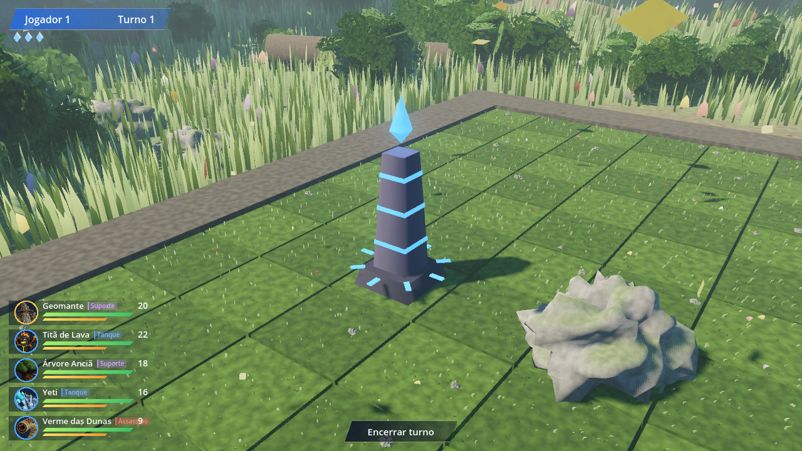

- **Santuários.** O boneco que chega a um santuário dourado escolhe uma bênção que vale até o fim da partida:
  **Ataque** (+2 de dano), **Defesa** (defende com 3 a menos no dado) ou **Velocidade** (+1 casa por movimento).
  Cada boneco recebe uma bênção por partida.
- **Dado de 20 lados.** Todo ataque com dano rola um d20 contra um mínimo calculado pelos atributos; o alvo rola a
  defesa. 1 sempre erra; 20 é crítico (+50% de dano, sem defesa).
- **Energia.** Cada golpe gasta energia do boneco, que volta 3 por turno. Golpes básicos custam 2 ou 3; os grandes,
  de 6 a 8.

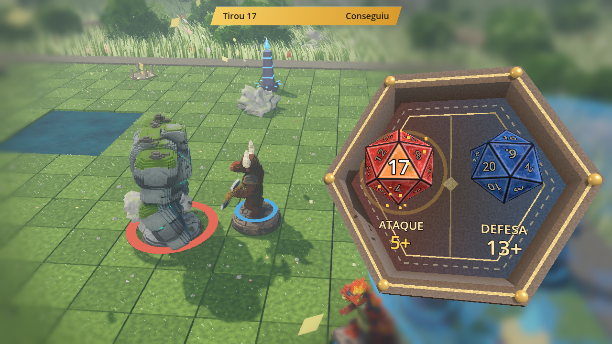

## Tipos de golpe

Todo golpe tem um tipo, com ícone e cor no menu e na ficha:

| Tipo | O que faz |
|---|---|
| Golpe Base | Ataque ou movimento principal |
| Proteção Pessoal | Protege ou recupera o próprio boneco |
| Proteção de Aliado | Ajuda um boneco do seu time |
| Mudança de Área | Muda o chão ou o ar de uma região (espinhos, lava, chão escaldante, areia, pólen, gelo) |
| Mudança de Status | Fortalece o boneco ou enfraquece o inimigo |
| Muralha | Ergue paredes altas que sobem do chão |

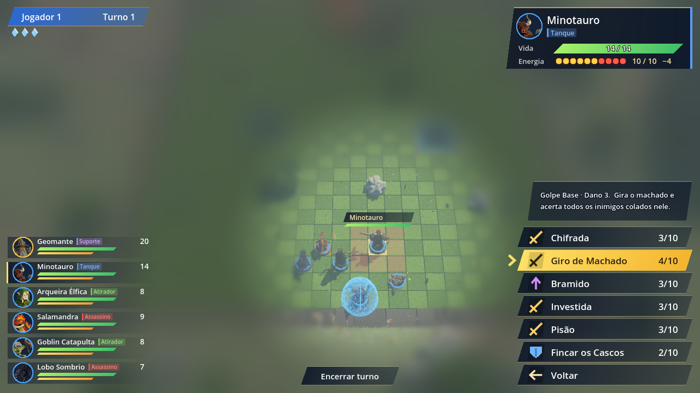

Alguns golpes: Flechada Potente (a exatamente 7 casas), Recuo Forçado, Meditação Élfica, Bomba de Espinhos,
Muro de Tronco, Pólen Atordoante, Drenagem, Mergulho, Tempestade de Areia, Abalo Sísmico, Arremesso de Rocha,
Salto Ígneo, Bola de Neve que cresce, Muro de Gelo, Mãos Penumbrais, Último Desejo, Território Vulcânico e
Muro de Obsidiana.

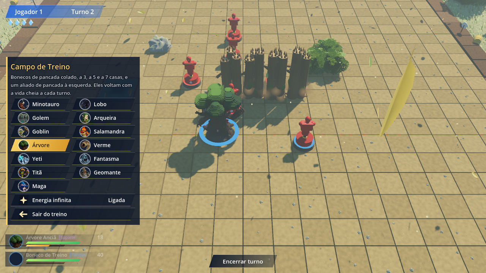

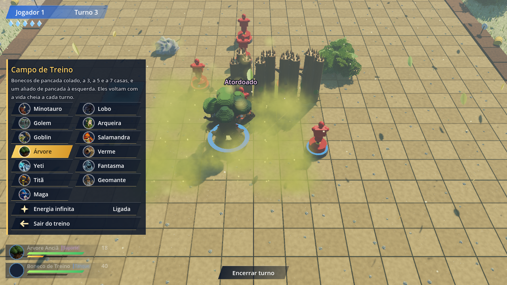

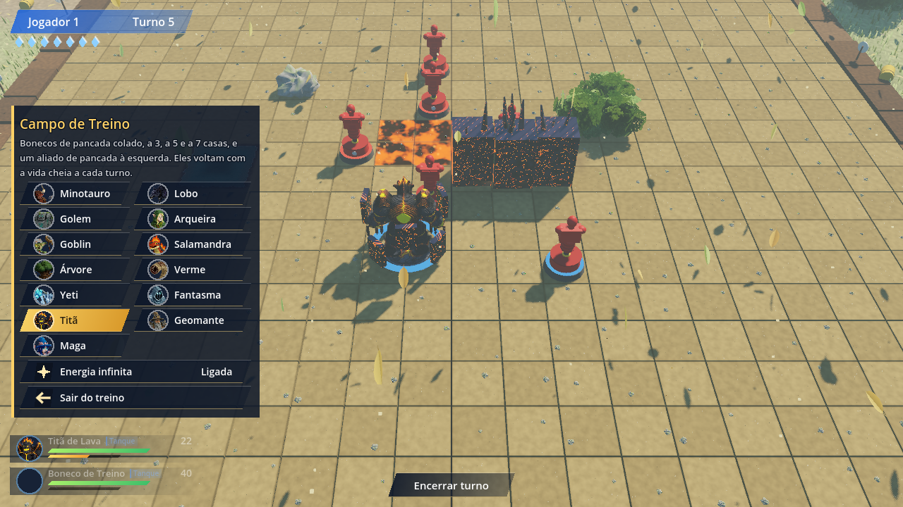

## Classes

| Classe | Bonecos | Papel |
|---|---|---|
| Tanque | Golem, Minotauro, Yeti, Titã de Lava | Aguenta golpes, segura a linha, protege |
| Assassino | Lobo Sombrio, Salamandra, Verme das Dunas | Entra pelos flancos e finaliza |
| Atirador | Arqueira Élfica, Goblin Catapulta | Age de longe e muda o terreno |
| Suporte | Árvore Anciã, Fantasma, Geomante, Maga das Marés | Cura, protege e controla |

Na escolha do exército, o botão **!** ao lado de cada boneco abre a ficha dele: classe, passiva, atributos e golpes.

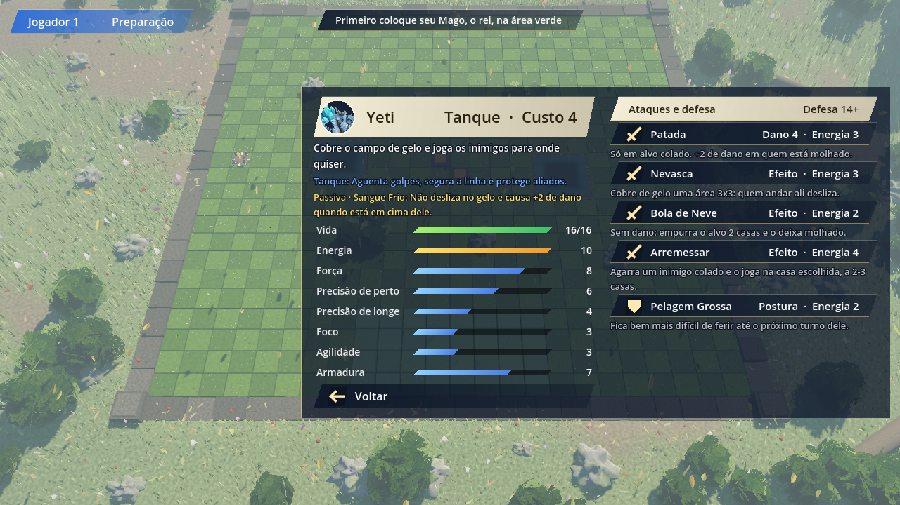

## Mapas e eventos aleatórios

Cinco mapas, cada um com 3 eventos. Cada evento é anunciado uma rodada antes num cartaz no meio da tela, com as casas
atingidas marcadas em vermelho; quando acontece, aparece o efeito no tabuleiro (chuva, neve, areia, pedras caindo...)
e, se durar mais de uma rodada, um aviso no canto mostra quantas rodadas faltam:

| Mapa | Eventos |
|---|---|
| Floresta Antiga | Névoa Fina, Raízes Vivas, Chuva de Verão |
| Dunas de Âmbar | Tempestade de Areia, Sol a Pino, Areia Movediça |
| Pântano Sombrio | Maré Cheia, Névoa do Brejo, Esporos |
| Picos Gelados | Nevasca, Geada, Avalanche |
| Caverna Cristalina | Desabamento, Cristal Ressonante, Escuridão |

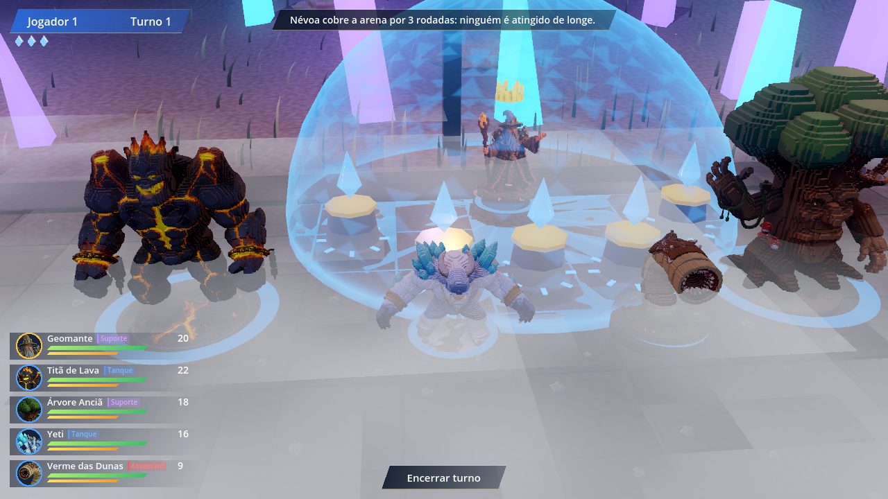

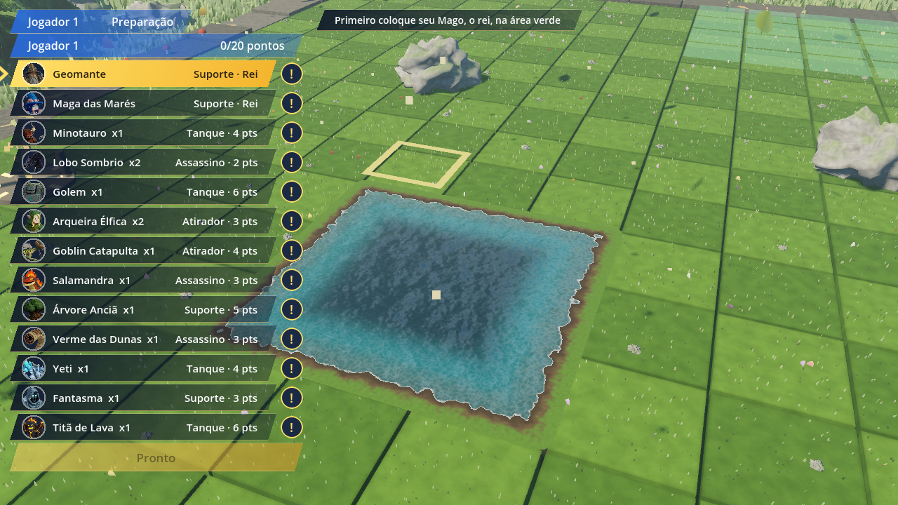

## Controles

- **W A S D**: mover a câmera
- **Botão esquerdo + arrastar**: girar
- **Roda do mouse**: aproximar
- **Botão direito**: voltar um passo
- **Esc**: menu

## Feedback

Jogou? Conte o que achou na aba **[Issues](../../issues)**: o que ficou confuso, o que está forte ou fraco demais,
bugs e ideias. Prints ajudam muito.

---

Versão 0.5 (protótipo). Feito com Godot 4.5. Este repositório traz apenas o jogo para download;
o código-fonte não está público.
